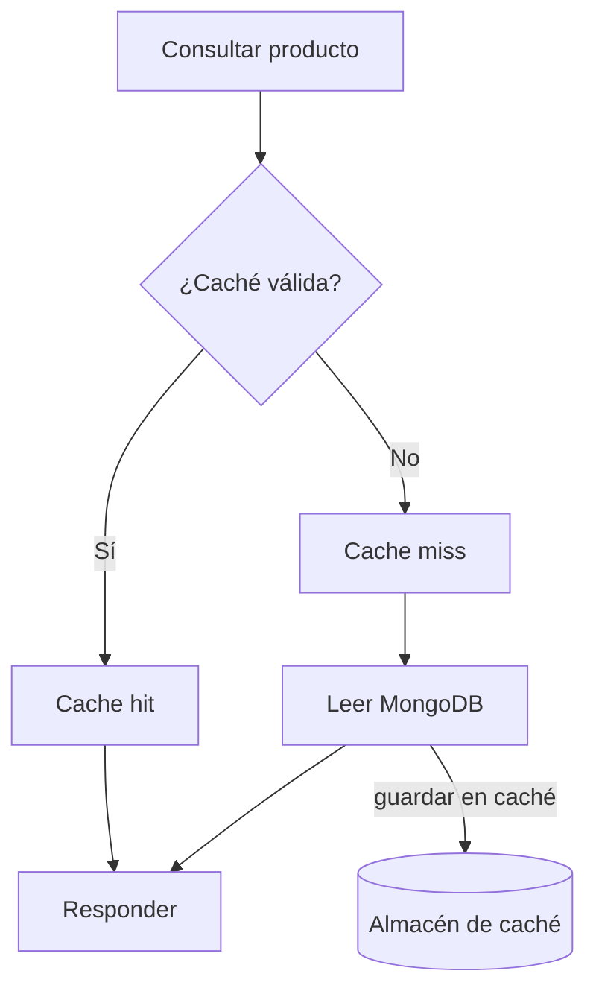
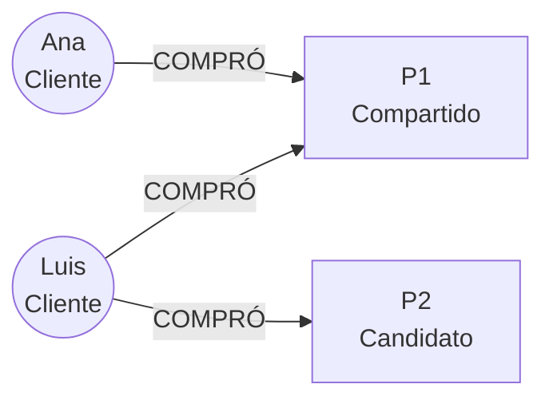

# NEXUS — Trabajo práctico integrador NoSQL

**Bases de Datos II**

**Entrega:** <!-- COMPLETAR (cátedra): fecha de entrega -->

**Resumen.** Cada equipo construye el backend de NEXUS combinando MongoDB, Redis y Neo4j. MongoDB es la fuente de verdad; la caché, la actividad y las relaciones de compra se resuelven con el motor que el equipo elija y justifique. La cátedra provee un repositorio base y siete escenarios de aceptación automáticos que el equipo debe hacer pasar.

## Índice

1. Introducción
2. Objetivos
3. Fuente de verdad y representaciones derivadas
4. Funcionalidades requeridas
5. Qué se solicita a los equipos
6. Condiciones técnicas
7. Repositorio base provisto por la cátedra
8. Repositorio y entregables
9. Escenarios de demostración obligatorios
10. Organización y alcance
11. Resultado esperado
12. Estado de los materiales

---

## 1. Introducción

<!-- REVISAR (cátedra): sección reconstruida, no estaba en el original -->

NEXUS es una plataforma de comercio simplificada concebida para practicar persistencia políglota: el uso coordinado de varias bases de datos NoSQL, cada una orientada a un patrón de acceso distinto. La plataforma gestiona un catálogo de productos, clientes y órdenes de compra, y ofrece consulta con caché, registro de actividad y recomendaciones.

El enunciado define qué debe poder hacer el sistema y cómo se verificará. La arquitectura interna y la elección de motores para las representaciones derivadas quedan a cargo de cada equipo.

## 2. Objetivos

<!-- REVISAR (cátedra): sección reconstruida, no estaba en el original -->

Al finalizar el trabajo, los equipos deberán ser capaces de:

- Identificar la fuente de verdad de los datos y distinguirla de las representaciones derivadas.
- Seleccionar y justificar el motor adecuado para cada patrón de acceso.
- Coordinar operaciones de negocio que involucran más de un motor.
- Tratar la invalidación de caché y los fallos parciales sin transacciones distribuidas.
- Explicar los compromisos de consistencia, rendimiento y complejidad de la persistencia políglota.

## 3. Fuente de verdad y representaciones derivadas

MongoDB es la fuente de verdad y está fijado por la cátedra. Las representaciones derivadas se implementan con el motor que cada equipo elija entre MongoDB, Redis y Neo4j.

| Responsabilidad | Motor | Qué debe resolver |
|---|---|---|
| Fuente de verdad | MongoDB (fijo) | Productos, clientes y órdenes; documentos embebidos, referencias, consultas y agregaciones. |
| Caché de productos | A elección del equipo | Lectura rápida de productos con expiración definida e invalidación ante cambios del catálogo. |
| Actividad | A elección del equipo | Contadores de visualizaciones, historial acotado por usuario y ranking de productos con mayor actividad. |
| Relaciones de compra | A elección del equipo | Conexiones entre clientes, productos y categorías; compras e intereses. |
| Recomendaciones | A elección del equipo | Candidatos a partir de las relaciones, excluyendo compras previas. |

Condiciones de la elección:

1. La solución utiliza los tres motores, y cada uno cumple una responsabilidad real. Se mantiene la regla de que ningún motor puede ser meramente decorativo.
2. Toda decisión se justifica en `docs/decisions.md`, indicando el patrón de acceso considerado y la alternativa descartada.

**Pistas para decidir** (no vinculantes). Conviene analizar el patrón de acceso de cada responsabilidad: lectura por clave con expiración, contadores atómicos, rankings ordenados y recorridos de relaciones entre entidades. Cada patrón favorece ciertas estructuras y penaliza otras; la justificación debe apoyarse en ese análisis.

## 4. Funcionalidades requeridas

### 4.1 Administración del catálogo — MongoDB

El sistema debe permitir registrar, modificar, eliminar lógicamente y consultar productos. Cada producto puede presentar atributos particulares según su categoría. Deben implementarse búsquedas por categoría, disponibilidad, rango de precios y otros atributos relevantes.

*Escenario:* un cliente busca notebooks disponibles dentro de un rango de precios y consulta sus características comerciales.

### 4.2 Consulta de productos con caché — fuente de verdad + caché

Al consultar un producto, la aplicación verifica si existe una entrada válida en el almacén de caché. Si la encuentra, responde con el valor temporal; de lo contrario consulta la fuente de verdad (MongoDB), devuelve el producto y lo incorpora a la caché con expiración definida. Cuando se modifica el catálogo, debe evitarse entregar valores obsoletos.



*Flujo conceptual de lectura.* Un fallo de caché implica consulta al origen y posterior almacenamiento temporal.

### 4.3 Registro de actividad — almacén de actividad

Se deben contar visualizaciones por producto, mantener un historial acotado de productos visitados recientemente por usuario y consultar los artículos con mayor actividad. Cada equipo deberá seleccionar y justificar el motor y las estructuras utilizadas.

### 4.4 Registro de compras — fuente de verdad + almacén de relaciones

Al efectuar una compra, se registra la orden en MongoDB, incluyendo los productos, cantidades y precios correspondientes al momento de la operación. La compra también debe reflejarse mediante relaciones en el almacén de relaciones.

*Escenario:* un cliente compra una notebook y un mouse; MongoDB conserva la orden y el almacén de relaciones refleja las conexiones. Si falla la actualización de las relaciones, el sistema debe detectar el estado parcial y permitir su recuperación o sincronización. No se exige una transacción distribuida.

### 4.5 Recomendaciones — almacén de relaciones + fuente de verdad

La aplicación identifica candidatos a partir de relaciones de compra, categorías e intereses mediante el almacén de relaciones. Debe excluir productos ya comprados por el usuario. MongoDB provee los detalles comerciales necesarios para presentar las recomendaciones.



*Ejemplo conceptual:* dos clientes compraron P1; P2 puede ser candidato para Ana porque Luis también lo compró y Ana aún no.

## 5. Qué se solicita a los equipos

| Área | Requisito | Evidencia |
|---|---|---|
| Infraestructura | Tres motores y una aplicación conectada | Entorno reproducible |
| Fuente de verdad — MongoDB | Productos, clientes, compras y consultas | Colecciones, datos y operaciones |
| Caché | Entradas con expiración e invalidación | Claves o documentos, estructuras y expiración |
| Actividad | Contadores, historial reciente y ranking | Estructuras utilizadas y consultas |
| Relaciones y recomendaciones | Relaciones de compra y candidatos | Modelo de relaciones y consultas |
| Decisiones de motor | Elección justificada por responsabilidad | Tabla en `docs/decisions.md` |
| Integración | Operaciones entre varios motores | Flujos funcionales |
| Consistencia | Invalidación y tratamiento de fallos | Procedimiento demostrado |
| Documentación | Modelo, arquitectura y ejecución | README, diagramas y ejemplos |

## 6. Condiciones técnicas

- Uso obligatorio de MongoDB, Redis y Neo4j, con integración real; MongoDB como fuente de verdad y los otros motores asignados por el equipo con justificación.
- Lenguaje: la cátedra provee un repositorio base en Python/FastAPI. Se puede utilizar otro lenguaje únicamente con autorización de la cátedra; en ese caso el equipo debe reproducir los contratos (endpoints y comportamiento observable) descritos en la sección 7.
- Entorno reproducible, preferentemente mediante Docker Compose.
- Aplicación backend que coordine las conexiones y operaciones; interfaz gráfica opcional.
- Dataset inicial común proporcionado por la cátedra para facilitar pruebas comparables.
- Operaciones persistentes con comportamiento definido ante reinicios, de acuerdo con cada almacenamiento.
- No se admite utilizar una sola base para toda la solución y las otras únicamente de forma decorativa.
- Consultas en el lenguaje nativo de cada motor (documentos de consulta y pipelines de agregación en MongoDB, comandos literales en Redis, Cypher en Neo4j) usando únicamente los drivers oficiales. En Redis los comandos se envían literales con `execute_command("ZINCRBY", ...)`, como en `redis-cli`, y no con los métodos de conveniencia del driver (`zincrby`, `set`, `get`...); MongoDB mantiene los métodos de `pymongo`, cuyo lenguaje de consulta ya es el nativo. No se admiten ORM/ODM/OGM ni constructores de consultas. Filtros, ordenamientos, agregaciones, conteos y recorridos de relaciones se resuelven en el motor; Python solo arma parámetros y mapea resultados. Ver [docs/guia-consultas.md](docs/guia-consultas.md).
<!-- REVISAR (cátedra): regla de lenguaje nativo agregada -->

## 7. Repositorio base provisto por la cátedra

<!-- REVISAR (cátedra): sección nueva, redactada a partir de las decisiones de diseño del starter -->

La cátedra entrega un repositorio base. Define con claridad qué viene resuelto y qué debe implementar cada equipo.

### 7.1 Qué provee la cátedra

| Componente | Detalle |
|---|---|
| API REST | Capa FastAPI con routers y contratos. |
| Dominio | Modelos de dominio. |
| Puertos | Interfaces por responsabilidad. |
| Wiring | Conexión de servicios y adaptadores. |
| Implementaciones en memoria | Activables con `ADAPTERS=fake`. |
| Infraestructura | Docker Compose con los tres motores. |
| Datos | Dataset de ejemplo y script de seed (`python -m scripts.seed`), que carga datos mediante los puertos. |
| Pruebas | Tests de aceptación de los siete escenarios (`tests/acceptance`) y tests unitarios de los flujos (`tests/unit`). |
| Documentación | Plantillas. |
| Demo de caché | Retardo configurable (`CACHE_MISS_DELAY_SECONDS`, 5 s en Compose) en la lectura de MongoDB cuando hay MISS, para que se vea la diferencia con el HIT. No requiere implementar nada. |
| Interfaz de prueba | UI web en `/ui` (HTML + JS, sin build) y Swagger UI en `/docs` para probar la API y los escenarios. |
| Clientes de base de datos | mongo-express, RedisInsight y Neo4j Browser (opcionales, perfil `clients` de Compose), más `make mongosh`, `make redis-cli` y `make cypher-shell`. |
<!-- REVISAR (cátedra): retardo de MISS (CACHE_MISS_DELAY_SECONDS) agregado a la lista de lo provisto, a pedido del docente -->
<!-- REVISAR (cátedra): interfaz de prueba (/ui) y Swagger (/docs) agregados a la lista de lo provisto -->
<!-- REVISAR (cátedra): clientes de base de datos (mongo-express, RedisInsight, consolas) agregados a la lista de lo provisto -->

### 7.2 Qué implementan los equipos

- **Adapters:** MongoDB (fijo) para productos, clientes y órdenes; el motor a elección para caché, actividad, relaciones de compra y recomendaciones.
- **Coordinación entre motores en los servicios:** cache-aside, invalidación, registro de compra con estado de sincronización, reconciliación y enriquecimiento de recomendaciones.

Los puntos a completar están marcados en el código como `TODO(alumnos)`. Mientras un TODO no esté implementado, la API responde HTTP 501.

### 7.3 Contratos observables

Los tests de aceptación verifican únicamente el siguiente comportamiento observable:

| Contrato | Comportamiento |
|---|---|
| `GET /products/{id}` | Devuelve el encabezado `X-Cache: HIT` o `X-Cache: MISS`. |
| `POST /products/{id}/views` | Registra una visualización. |
| Órdenes | Persisten `sync_status` (`pending`, `synced` o `failed`) respecto del almacén de relaciones. |
| `POST /admin/faults` | Con `{"relations_down": true}` simula la caída del almacén de relaciones. |
| `GET /admin/sync-status` | Informa el estado de sincronización de las órdenes. |
| `POST /admin/reconcile` | Ejecuta la reconciliación de órdenes no sincronizadas. |
| `GET /customers/{id}/recommendations` | Devuelve las recomendaciones del cliente. |

### 7.4 Restricciones

Los equipos no deben modificar los routers, los contratos ni los tests de aceptación. Sí pueden agregar sus propios tests.

<!-- REVISAR (cátedra): tabla de lenguaje nativo / sin ORM agregada -->

**Lenguaje nativo y sin ORM.** El motor hace el trabajo; Python arma parámetros y mapea resultados.

| Permitido | No permitido |
|---|---|
| `pymongo` con filtros, proyecciones y pipelines de agregación | MongoEngine, Beanie, ODMantic, umongo u otros ODM |
| Redis con comandos literales vía `execute_command("ZINCRBY", ...)` (también dentro de `pipeline()`) | Métodos de conveniencia del driver de Redis (`zincrby`, `set`, `get`, `lrange`...) y redis-om u otras capas de objetos |
| Driver `neo4j` con Cypher parametrizado | neomodel, OGM de py2neo u otros OGM |
| Índices y restricciones creados por el equipo | SQLAlchemy, SQLModel u otros query builders |
| Python para armar parámetros y mapear resultados a los modelos de dominio | Traer colecciones completas y filtrar u ordenar en Python |
| Un recorrido de relaciones en una sola consulta Cypher | Recorrer relaciones con bucles en Python (una consulta por nodo) |
| Cypher con `$parametros` | Armar Cypher concatenando strings con datos del usuario |

Cómo se controla:

- `tests/test_no_orm.py` verifica automáticamente imports y dependencias prohibidas (`uv run pytest tests/test_no_orm.py`) y que `Connections.redis` solo acepte `execute_command` y `pipeline`.
- La evidencia de `explain()` / `PROFILE` se registra en `docs/decisions.md`.
- Se consulta en la defensa oral.

Ejemplos de sintaxis por motor: [docs/guia-consultas.md](docs/guia-consultas.md).

## 8. Repositorio y entregables

Cada equipo entregará el enlace a un repositorio Git que contenga el código, la configuración y las evidencias necesarias para ejecutar y verificar el proyecto. La estructura parte del repositorio base y debe permitir localizar los componentes principales.

```text
nexus/
├── README.md
├── ENUNCIADO.md
├── compose.yaml
├── .env.example
├── docs/
│   ├── architecture.md
│   ├── data-model.md
│   └── decisions.md
├── datasets/
│   ├── products.json
│   ├── customers.json
│   └── orders.json
├── scripts/
│   └── seed/
├── tests/
│   ├── unit/
│   └── acceptance/
└── app/
    ├── catalog/
    ├── customers/
    ├── activity/
    ├── orders/
    ├── recommendations/
    ├── admin/
    └── ...
```

<!-- REVISAR (cátedra): el árbol se reconstruyó a partir del starter; el original mostraba nexus-nosql/ -->

- Aplicación funcional y configuraciones, sin contraseñas ni secretos en el repositorio.
- Scripts para inicializar las bases desde un estado conocido.
- Documentación de responsabilidades, flujos e integración de tecnologías.
- Instrucciones de ejecución y ejemplos reproducibles de uso.
- Pruebas o comandos ejecutables que demuestren los escenarios requeridos.

## 9. Escenarios de demostración obligatorios

| N.º | Escenario | Descripción | Cómo se verifica |
|---|---|---|---|
| 01 | Primera consulta | MongoDB responde y se crea una entrada de caché. | `X-Cache: MISS` en `GET /products/{id}`; `tests/acceptance/test_01_first_read_miss.py` |
| 02 | Consulta repetida | Se usa la caché para evitar consultar de nuevo la fuente principal. | `X-Cache: HIT` en la segunda consulta; `tests/acceptance/test_02_repeated_read_hit.py` |
| 03 | Actualización | La caché no continúa entregando una versión obsoleta. | Consulta posterior a una modificación devuelve el dato actualizado; `tests/acceptance/test_03_update_invalidates.py` |
| 04 | Visualizaciones | Se actualizan contadores y actividad reciente. | `POST /products/{id}/views`, `GET /products/{id}/views`, `GET /customers/{id}/recent` y `GET /activity/top`; `tests/acceptance/test_04_views_activity.py` |
| 05 | Compra | Se crea una orden y se actualizan las relaciones. | Orden con `sync_status` `synced`; `tests/acceptance/test_05_purchase.py` |
| 06 | Recomendaciones | El almacén de relaciones determina candidatos y MongoDB aporta detalles; se excluyen compras previas. | `GET /customers/{id}/recommendations`; `tests/acceptance/test_06_recommendations.py` |
| 07 | Fallo parcial | Se demuestra la detección y recuperación o reconciliación de datos. | `POST /admin/faults`, `GET /admin/sync-status`, `POST /admin/reconcile`; `tests/acceptance/test_07_partial_failure.py` |

## 10. Organización y alcance

Se recomienda trabajar en grupos de 3 a 5 estudiantes. Para una cohorte de 300 alumnos, los grupos de cinco representan aproximadamente 60 repositorios. El objetivo académico está en las bases de datos y su integración, no en construir un e-commerce completo.

**Fuera de alcance:** pasarelas de pago, autenticación compleja, gestión de envíos, interfaces avanzadas y despliegue productivo en la nube.

**Evaluación.** La solución grupal evidencia el funcionamiento del sistema, pero no garantiza por sí sola el aprendizaje de cada integrante. Se recomienda complementarla con una defensa oral y preguntas individuales de validación sobre el proyecto, en particular sobre las decisiones de motor registradas en `docs/decisions.md`.

<!-- REVISAR (cátedra): párrafo de evaluación ampliado respecto del original; no se fijan ponderaciones -->

## 11. Resultado esperado

El equipo deberá demostrar una solución en la que diferentes bases NoSQL responden a distintos patrones de acceso y colaboran mediante operaciones concretas de negocio. Se espera que puedan identificar la fuente de verdad de los datos, mantener representaciones derivadas y explicar los compromisos de consistencia, rendimiento y complejidad que introduce la persistencia políglota.

## 12. Estado de los materiales

| Material | Estado |
|---|---|
| Dataset | El dataset de ejemplo provisto será reemplazado por el dataset común de la cátedra (productos, clientes, categorías y compras). |
| Contratos mínimos | Endpoints y puertos del repositorio base, sin imponer la arquitectura interna. |
| Criterios de aceptación automáticos | Tests de aceptación ya provistos para los siete escenarios demostrables. |

**Principio de diseño:** libertad de implementación interna, con datos iniciales y comportamientos observables estandarizados para facilitar una corrección homogénea.
