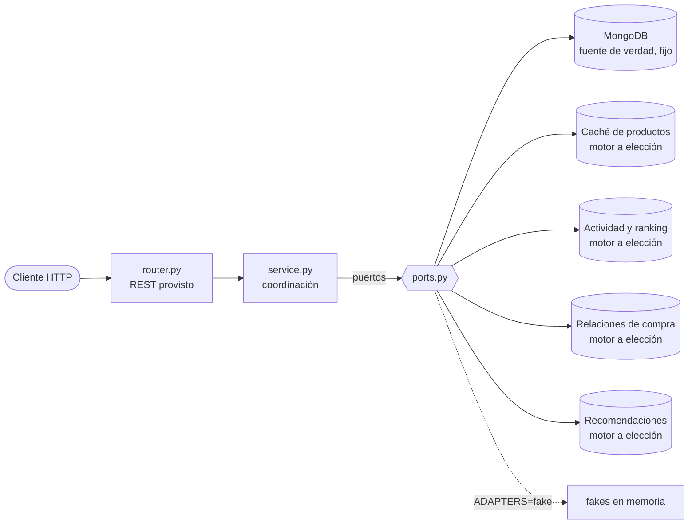

# NEXUS — Trabajo práctico integrador NoSQL

> **Enunciado completo del TP: [ENUNCIADO.md](ENUNCIADO.md)**

NEXUS es una tienda de tecnología con **tres motores de base de datos, cada uno con un trabajo distinto** (persistencia políglota). La cátedra les da la API REST, los modelos, las interfaces y el cableado. **Ustedes implementan los adaptadores y la coordinación entre motores.** MongoDB es la fuente de verdad (fija); **el motor de cada representación derivada lo eligen ustedes**, con la condición de usar los tres motores con una responsabilidad real y justificar cada elección en [docs/decisions.md](docs/decisions.md).

> El dataset de `datasets/` es de muestra. La cátedra publicará un dataset común que lo reemplaza; el formato de los archivos se mantiene.

## Camino rápido

```bash
cp .env.example .env            # configuración local (no se commitea)
docker compose up --build -d   # MongoDB + Redis + Neo4j + API en http://localhost:8000
curl localhost:8000/health     # los tres motores deben decir "ok"
make seed                      # carga el dataset (falla hasta que implementen los adaptadores base)
make test-acceptance           # los 7 escenarios; arrancan en rojo
```

Sin Docker, para practicar los flujos de servicio con datos en memoria:

```bash
uv sync
ADAPTERS=fake uv run uvicorn app.main:app --reload   # API con fakes y dataset ya cargado
uv run pytest tests/unit                              # arrancan en rojo hasta que implementen los servicios
```

Mientras algo no esté implementado, la API responde **501** con el mensaje `TODO(alumnos): ...` que dice qué falta.

## Responsabilidad de cada motor

| Responsabilidad | Motor | Qué guarda |
|-----------------|-------|------------|
| Fuente de verdad (productos, clientes, órdenes) | **MongoDB (fijo)** | Productos (con `attributes` según categoría), clientes, órdenes (ítems con precio al momento de la compra) |
| Caché de productos (con TTL) | A elección del equipo | Copia de productos con vencimiento |
| Contadores de vistas, actividad reciente y ranking | A elección del equipo | Vistas por producto, historial por cliente, más vistos |
| Relaciones de compra | A elección del equipo | Quién compró qué, categoría de cada producto, intereses del cliente |
| Recomendaciones | A elección del equipo | Candidatos "también compraron" y por categoría de interés |

**Condición:** entre todas las responsabilidades a elección deben usar **MongoDB, Redis y Neo4j** con una responsabilidad real cada uno, y justificar cada elección en `docs/decisions.md` (tabla obligatoria al inicio).

Reglas de oro: todo lo derivado (caché, actividad, relaciones) **se reconstruye desde MongoDB**. No hay transacciones distribuidas: la consistencia entre motores se coordina en los servicios.

## Arquitectura



Cada módulo (`catalog`, `customers`, `activity`, `orders`, `recommendations`) tiene la misma forma: `domain.py` (modelos), `ports.py` (interfaces con la semántica esperada), `service.py`, `router.py` y `adapters/`. Detalle en [docs/architecture.md](docs/architecture.md).

## Qué tienen que implementar ustedes

Buscá `TODO(alumnos)` con `rg "TODO\(alumnos\)" app`. Cada uno lanza `NotImplementedError` y su docstring explica los pasos.

### Adaptadores

Los `mongo_*.py` usan MongoDB (fijo). Los otros cuatro reciben el objeto `Connections` completo (`mongo`, `redis`, `neo4j`) y **ustedes eligen el motor**.

| Archivo | Escenarios |
|---------|-----------|
| `app/catalog/adapters/mongo_product_repository.py` | 01, 03, 05, 06 y búsquedas |
| `app/catalog/adapters/product_cache.py` (motor a elección) | 01, 02, 03 |
| `app/customers/adapters/mongo_customer_repository.py` | 05, 06 |
| `app/activity/adapters/activity_store.py` (motor a elección) | 04 |
| `app/orders/adapters/mongo_order_repository.py` | 05, 07 |
| `app/orders/adapters/purchase_relations.py` (motor a elección) | 05, 07 |
| `app/recommendations/adapters/recommendation_finder.py` (motor a elección) | 06 |

### Coordinación entre motores (servicios)

| Archivo | Método | Escenarios |
|---------|--------|-----------|
| `app/catalog/service.py` | `get_product` (cache-aside) | 01, 02 |
| `app/catalog/service.py` | `update`, `delete` (+ invalidación) | 03 |
| `app/orders/service.py` | `place_order` (Mongo → relaciones de compra, estado de sincronización) | 05, 07 |
| `app/orders/service.py` | `reconcile` | 07 |
| `app/recommendations/service.py` | `recommend` (candidatos del finder + detalles de Mongo) | 06 |

### Checklist

- [ ] Los tres motores responden en `/health`
- [ ] `make seed` carga el dataset sin errores
- [ ] `make test-unit` en verde
- [ ] `make test-acceptance` en verde (escenarios 01 a 07)
- [ ] `docs/data-model.md` completo (estructuras y claves elegidas)
- [ ] `docs/decisions.md` completo: **tabla de motores elegidos** (obligatoria) y justificaciones
- [ ] Usan los tres motores con responsabilidad real
- [ ] `uv run pytest tests/test_no_orm.py` en verde y evidencia de `explain()`/`PROFILE` en `docs/decisions.md`

<!-- REVISAR (cátedra): regla de lenguaje nativo agregada -->
> **Regla: lenguaje nativo, sin ORM.** Las consultas se escriben en el lenguaje de cada motor (filtros y pipelines en MongoDB, comandos en Redis, Cypher en Neo4j) con los drivers oficiales. Sin ORM/ODM/OGM, y el filtrado, ordenamiento, conteo y recorrido se hace en el motor, no en Python. Detalle en [ENUNCIADO.md](ENUNCIADO.md) (secciones 6 y 7.4), ejemplos en [docs/guia-consultas.md](docs/guia-consultas.md). Se verifica con `uv run pytest tests/test_no_orm.py`.

**Fuera del alcance:** autenticación, frontend, descontar stock al comprar (pueden agregarlo y justificarlo en `decisions.md`).

## Los 7 escenarios con curl

Los ids vienen de `datasets/`. Asumí `B=http://localhost:8000`.

| # | Qué se demuestra | Comando | Qué mirar |
|---|------------------|---------|-----------|
| 01 | Primera lectura: responde Mongo y se crea la entrada de caché | `curl -i $B/products/nb-001` | `X-Cache: MISS` |
| 02 | Lectura repetida: responde la caché | `curl -i $B/products/nb-001` | `X-Cache: HIT` |
| 03 | Actualizar no deja caché vieja | `curl -X PUT $B/products/nb-001 -H 'content-type: application/json' -d '{"price":1100}'` y luego `curl -i $B/products/nb-001` | precio nuevo, `MISS` |
| 04 | Vistas: contadores e historial | `curl -X POST $B/products/nb-001/views -H 'content-type: application/json' -d '{"customer_id":"c-008"}'`; luego `curl $B/products/nb-001/views`, `curl $B/customers/c-008/recent`, `curl $B/activity/top` | contador +1, historial, ranking |
| 05 | Compra: orden en Mongo + relaciones de compra | `curl -X POST $B/orders -H 'content-type: application/json' -d '{"customer_id":"c-008","items":[{"product_id":"ms-001","quantity":1}]}'` | `sync_status: synced` |
| 06 | Recomendaciones | `curl $B/customers/c-001/recommendations` | candidatos con detalles, sin `nb-001` ni `ms-001` |
| 07 | Falla parcial | ver abajo | `failed` → detectado → `synced` |

Escenario 07 paso a paso:

```bash
curl -X POST $B/admin/faults -H 'content-type: application/json' -d '{"relations_down": true}'
curl -X POST $B/orders -H 'content-type: application/json' \
     -d '{"customer_id":"c-008","items":[{"product_id":"ms-001","quantity":1}]}'   # sync_status: failed
curl $B/admin/sync-status                                                          # detección
curl -X POST $B/admin/faults -H 'content-type: application/json' -d '{"relations_down": false}'
curl -X POST $B/admin/reconcile                                                    # recuperación
curl $B/admin/sync-status                                                          # ya no hay pendientes
```

Búsqueda (atributos con prefijo `attr.`): `curl "$B/products?category=notebooks&min_price=500&available=true&attr.ram_gb=16"`

## Decisiones de diseño ya tomadas por la cátedra

- **Las vistas se registran con `POST /products/{id}/views`**, no con `GET`, para que la caché (01-03) y la actividad (04) se puedan probar por separado.
- **La orden se responde con 201 aunque las relaciones de compra fallen:** la compra quedó en Mongo; el estado `failed` es lo que se detecta y recupera.
- **MongoDB es fijo; lo derivado es a elección:** las representaciones derivadas (caché, actividad, relaciones, recomendaciones) pueden vivir en MongoDB, Redis o Neo4j, siempre que se cumpla la condición de los tres motores.
- **Python simple:** drivers síncronos (`pymongo`, `redis`, `neo4j`), funciones comunes sin `async`.

## Estructura

```
app/            código (módulos por dominio, container.py = cableado)
datasets/       datos de muestra (JSON)
scripts/seed/   carga inicial: python -m scripts.seed
tests/unit/     flujos de servicio con fakes
tests/acceptance/  escenarios 01-07 contra la API
docs/           architecture.md (provisto), data-model.md y decisions.md (para completar)
```
