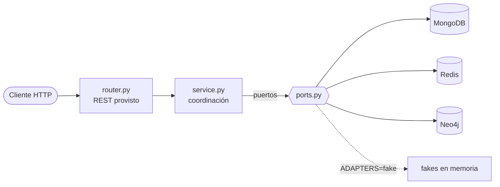

# NEXUS — Trabajo práctico integrador NoSQL

NEXUS es una tienda de tecnología con **tres motores de base de datos, cada uno con un trabajo distinto** (persistencia políglota). La cátedra les da la API REST, los modelos, las interfaces y el cableado. **Ustedes implementan los adaptadores de cada motor y la coordinación entre ellos.**

> El dataset de `datasets/` es de muestra. La cátedra publicará un dataset común que lo reemplaza; el formato de los archivos se mantiene.

## Camino rápido

```bash
cp .env.example .env            # configuración local (no se commitea)
docker compose up --build -d   # MongoDB + Redis + Neo4j + API en http://localhost:8000
curl localhost:8000/health     # los tres motores deben decir "ok"
make seed                      # carga el dataset (falla hasta que implementen los adaptadores base)
make test-acceptance           # los 7 escenarios; arrancan en rojo
```

Sin Docker, para practicar los flujos de servicio con datos en memoria:

```bash
uv sync
ADAPTERS=fake uv run uvicorn app.main:app --reload   # API con fakes y dataset ya cargado
uv run pytest tests/unit                              # arrancan en rojo hasta que implementen los servicios
```

Mientras algo no esté implementado, la API responde **501** con el mensaje `TODO(alumnos): ...` que dice qué falta.

## Responsabilidad de cada motor

| Motor | Rol | Qué guarda |
|-------|-----|------------|
| MongoDB | Fuente de verdad | Productos (con `attributes` según categoría), clientes, órdenes (ítems con precio al momento de la compra) |
| Redis | Caché y actividad | Caché de productos con TTL, contadores de vistas, historial reciente por cliente, ranking de más vistos |
| Neo4j | Relaciones | `Customer-PURCHASED->Product`, `Product-IN_CATEGORY->Category`, `Customer-INTERESTED_IN->Category` |

Reglas de oro: si Redis o Neo4j se pierden, **se reconstruyen desde MongoDB**. No hay transacciones distribuidas: la consistencia entre motores se coordina en los servicios.

## Arquitectura



Cada módulo (`catalog`, `customers`, `activity`, `orders`, `recommendations`) tiene la misma forma: `domain.py` (modelos), `ports.py` (interfaces con la semántica esperada), `service.py`, `router.py` y `adapters/`. Detalle en [docs/architecture.md](docs/architecture.md).

## Qué tienen que implementar ustedes

Buscá `TODO(alumnos)` con `rg "TODO\(alumnos\)" app`. Cada uno lanza `NotImplementedError` y su docstring explica los pasos.

### Adaptadores (cada motor)

| Archivo | Escenarios |
|---------|-----------|
| `app/catalog/adapters/mongo_product_repository.py` | 01, 03, 05, 06 y búsquedas |
| `app/catalog/adapters/redis_product_cache.py` | 01, 02, 03 |
| `app/customers/adapters/mongo_customer_repository.py` | 05, 06 |
| `app/activity/adapters/redis_activity_store.py` | 04 |
| `app/orders/adapters/mongo_order_repository.py` | 05, 07 |
| `app/orders/adapters/neo4j_purchase_graph.py` | 05, 07 |
| `app/recommendations/adapters/neo4j_recommendation_graph.py` | 06 |

### Coordinación entre motores (servicios)

| Archivo | Método | Escenarios |
|---------|--------|-----------|
| `app/catalog/service.py` | `get_product` (cache-aside) | 01, 02 |
| `app/catalog/service.py` | `update`, `delete` (+ invalidación) | 03 |
| `app/orders/service.py` | `place_order` (Mongo → Neo4j, estado de sincronización) | 05, 07 |
| `app/orders/service.py` | `reconcile` | 07 |
| `app/recommendations/service.py` | `recommend` (Neo4j + detalles de Mongo) | 06 |

### Checklist

- [ ] Los tres motores responden en `/health`
- [ ] `make seed` carga el dataset sin errores
- [ ] `make test-unit` en verde
- [ ] `make test-acceptance` en verde (escenarios 01 a 07)
- [ ] `docs/data-model.md` completo (estructuras y claves elegidas)
- [ ] `docs/decisions.md` completo (justificaciones)

**Fuera del alcance:** autenticación, frontend, descontar stock al comprar (pueden agregarlo y justificarlo en `decisions.md`).

## Los 7 escenarios con curl

Los ids vienen de `datasets/`. Asumí `B=http://localhost:8000`.

| # | Qué se demuestra | Comando | Qué mirar |
|---|------------------|---------|-----------|
| 01 | Primera lectura: responde Mongo y se crea la entrada de caché | `curl -i $B/products/nb-001` | `X-Cache: MISS` |
| 02 | Lectura repetida: responde Redis | `curl -i $B/products/nb-001` | `X-Cache: HIT` |
| 03 | Actualizar no deja caché vieja | `curl -X PUT $B/products/nb-001 -H 'content-type: application/json' -d '{"price":1100}'` y luego `curl -i $B/products/nb-001` | precio nuevo, `MISS` |
| 04 | Vistas: contadores e historial | `curl -X POST $B/products/nb-001/views -H 'content-type: application/json' -d '{"customer_id":"c-008"}'`; luego `curl $B/products/nb-001/views`, `curl $B/customers/c-008/recent`, `curl $B/activity/top` | contador +1, historial, ranking |
| 05 | Compra: orden en Mongo + grafo | `curl -X POST $B/orders -H 'content-type: application/json' -d '{"customer_id":"c-008","items":[{"product_id":"ms-001","quantity":1}]}'` | `graph_sync_status: synced` |
| 06 | Recomendaciones | `curl $B/customers/c-001/recommendations` | candidatos con detalles, sin `nb-001` ni `ms-001` |
| 07 | Falla parcial | ver abajo | `failed` → detectado → `synced` |

Escenario 07 paso a paso:

```bash
curl -X POST $B/admin/faults -H 'content-type: application/json' -d '{"neo4j_down": true}'
curl -X POST $B/orders -H 'content-type: application/json' \
     -d '{"customer_id":"c-008","items":[{"product_id":"ms-001","quantity":1}]}'   # graph_sync_status: failed
curl $B/admin/sync-status                                                          # detección
curl -X POST $B/admin/faults -H 'content-type: application/json' -d '{"neo4j_down": false}'
curl -X POST $B/admin/reconcile                                                    # recuperación
curl $B/admin/sync-status                                                          # ya no hay pendientes
```

Búsqueda (atributos con prefijo `attr.`): `curl "$B/products?category=notebooks&min_price=500&available=true&attr.ram_gb=16"`

## Decisiones de diseño ya tomadas por la cátedra

- **Las vistas se registran con `POST /products/{id}/views`**, no con `GET`, para que la caché (01-03) y la actividad (04) se puedan probar por separado.
- **La orden se responde con 201 aunque el grafo falle:** la compra quedó en Mongo; el estado `failed` es lo que se detecta y recupera.
- **Python simple:** drivers síncronos (`pymongo`, `redis`, `neo4j`), funciones comunes sin `async`.

## Estructura

```
app/            código (módulos por dominio, container.py = cableado)
datasets/       datos de muestra (JSON)
scripts/seed/   carga inicial: python -m scripts.seed
tests/unit/     flujos de servicio con fakes
tests/acceptance/  escenarios 01-07 contra la API
docs/           architecture.md (provisto), data-model.md y decisions.md (para completar)
```
