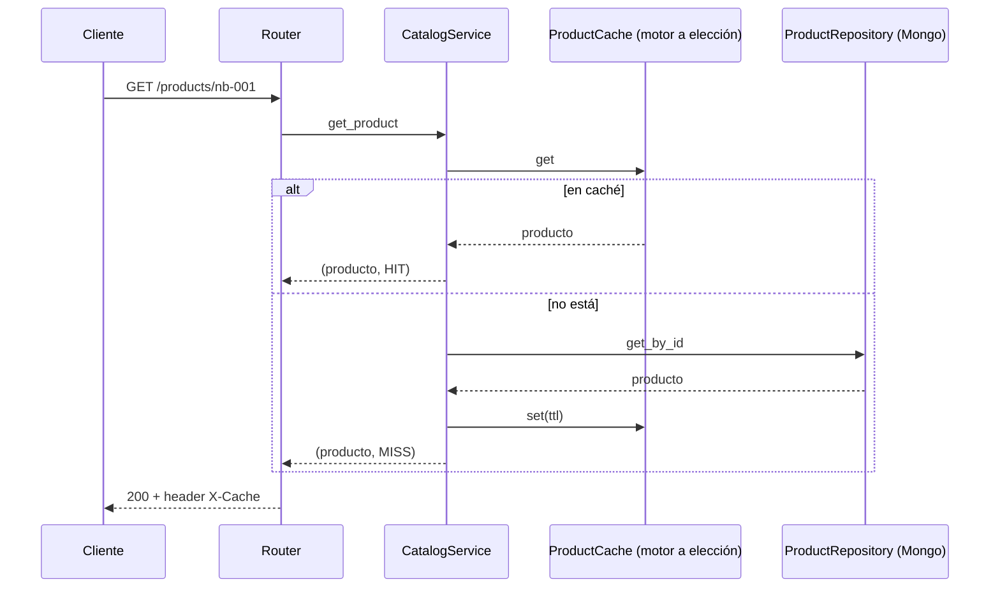
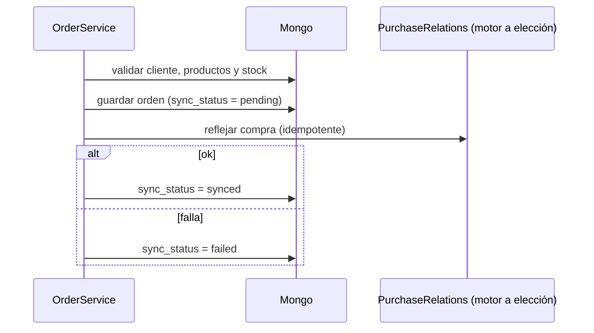

# Arquitectura

**Cada petición pasa por `router → service → puerto → adaptador`. Los puertos son las interfaces; los adaptadores hablan con un motor.** Ustedes escriben adaptadores y la coordinación en los servicios.

## Flujo de una lectura con caché (escenarios 01-02)

## Flujo de una compra (escenarios 05 y 07)

La orden **nunca** se pierde: MongoDB es la verdad y las relaciones de compra son una proyección derivada que se puede reconstruir (`reconcile`).

## Mapa de carpetas

| Pieza | Quién la escribe | Para qué |
|-------|------------------|----------|
| `domain.py` | Cátedra | Modelos pydantic |
| `ports.py` | Cátedra | Contrato de cada adaptador (docstrings = semántica esperada) |
| `router.py` | Cátedra | REST completo |
| `service.py` | Mixto | Provisto lo trivial; `TODO(alumnos)` donde hay coordinación entre motores |
| `adapters/` | **Alumnos** | Mongo (fijo) y los almacenes derivados (motor a elección: caché, actividad, relaciones, recomendaciones) |
| `app/fakes.py` | Cátedra | Todos los puertos en memoria |
| `app/container.py` | Cátedra | Elige real/fake según `ADAPTERS` |
| `app/admin/faults.py` | Cátedra | `FaultyPurchaseRelations`: simula las relaciones de compra caídas |
| `app/infrastructure/` | Cátedra | Conexiones y mapeo `id` ↔ `_id` |
| `app/seeding.py` | Cátedra | Carga el dataset usando los puertos |

## Observabilidad que usan los tests

| Qué | Dónde |
|-----|-------|
| Origen de la lectura | Header `X-Cache: HIT \| MISS` en `GET /products/{id}` |
| Estado de sincronización por orden | Campo `sync_status` (`pending \| synced \| failed`) persistido en Mongo |
| Falla inyectada | `POST /admin/faults {"relations_down": true}` |
| Detección | `GET /admin/sync-status` |
| Recuperación | `POST /admin/reconcile` |

## Reglas que los puertos imponen

- El repositorio de productos **no filtra por `active`** (salvo `search`): el servicio decide.
- `PurchaseRelations` es **idempotente**: ejecutar dos veces deja lo mismo que una.
- `RecommendationFinder` devuelve **solo ids y puntajes**; los datos comerciales vienen de Mongo.
- `ActivityStore`, `ProductCache`, `PurchaseRelations` y `RecommendationFinder` **no imponen motor ni estructura**: los eligen ustedes y los justifican en `docs/decisions.md`.
- Entre todos los almacenes derivados deben usarse **MongoDB, Redis y Neo4j** con una responsabilidad real cada uno.
